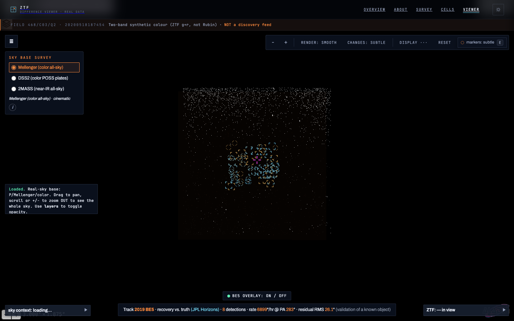
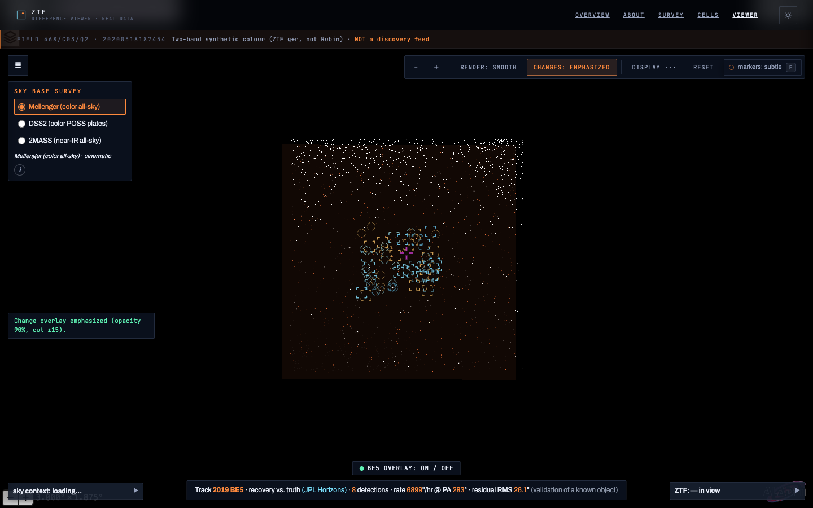
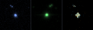
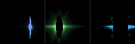
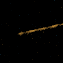

# noctis-imaging-pipeline

A difference-imaging pipeline for the **Zwicky Transient Facility** (ZTF) public archive:
it downloads survey images of a patch of sky, aligns them, finds what *changed* in ZTF's own
official difference image, measures every change, and classifies what it can — stationary source
(variable star / AGN / supernova) or moving object (asteroid / satellite), real or artifact.

It runs on a laptop. CPU only, no GPU anywhere.

> **This pipeline has made no discoveries.** It has *recovered* known objects — the 2019 BE5
> near-Earth asteroid, found blind and then confirmed against JPL Horizons — and it produces
> *candidates* and *verdicts*. Nothing here is an alert feed. That distinction is enforced in
> the code, not just the docs: novelty is a three-state value (`known` / `novel` / `unchecked`),
> and "I could not ask the catalogue" never collapses into "I asked and found nothing".

---

## About

**Research & Development Project developed through PVNet Advanced Technology Research & Education Internship Program.**

**Not an official ZTF, Rubin Observatory, SLAC, NASA, or Palomar Observatory project.**

This is an independent student project. None of those organizations endorse it or are involved
in it. It uses public ZTF archive imagery and pretrained models that their authors published openly
(see [Attribution](#attribution)).

- **Ryan Bjork — Lead Developer** (summer research project, PVNet Advanced Technology Research & Education Internship Program)
- Website: [noctisimaging.com/showcase](https://noctisimaging.com/showcase/) ·
  project page: [what this is and is not](https://noctisimaging.com/showcase/about.html)

The "NOCTIS ARRAY" observatory on the website is a design skin. There is no such observatory; the
data and numbers underneath it are real and come from this repository's runs.

---

## What it does today, and what is not built yet

### Working today

One survey, a limited set of sky.

- **Real ZTF data only.** Every image the pipeline processes comes from the Zwicky Transient
  Facility's public archive of Palomar imaging, served by IRSA. (The website's background sky
  layers are third-party all-sky surveys, shown for context only.)
- **A limited set of fields and nights.** The survey map, sky cells and difference viewer on the
  website show the patches of sky processed so far, not the whole sky.
- **Recoveries, not discoveries.** It found the known asteroid 2019 BE5 without being told where
  to look. It has not discovered anything new.

What the pipeline does, end to end:

- Queries IRSA for one ZTF grid cell, picks science and reference epochs, downloads, aligns.
- Runs detection and measurement on **ZTF's official difference image** — this pipeline does not
  yet use its own subtraction to find changes.
- Builds a deep multi-year median reference, used only for the reference channel of the
  sci/ref/diff cutouts.
- Motion branch: DeepStreaks cascade on elongated sources, intra-night linking across exposures
  and fields, SkyBoT cross-match. This is the route that recovered 2019 BE5.
- Stationary classification as a separate, bounded pass: braai and ALeRCE's hosted stamp-classifier
  results, only for detections that match a known ALeRCE object (top 20 per sky cell by default).
- A resumable, parallel survey harvester with a SQLite store, and exporters that turn the store
  into the website's JSON, blink stacks, FITS and thumbnails.

### Planned / not yet built

More data, more sky, more surveys:

- **More images and data on the platform.** Process more nights and more exposures, so each patch
  of sky has a longer record.
- **Images from different fields.** Add more parts of the sky beyond the fields covered today.
- **Expanding beyond ZTF.** Bring in imaging from other surveys, so the pipeline is not tied to one
  telescope.

Pipeline work:

- **Our own subtraction in the main path.** Alard–Lupton and ZOGY subtraction exist only in
  `notebooks/stage2_subtraction.ipynb`, and our difference carries ~12× the residual noise of ZTF's.
- **Sub-pixel registration and PSF matching**, to remove the registration dipole that drops braai
  to ~0.05–0.14 on our own cutouts.
- **Light-curve classifier.** Validated standalone on 30 alert-rich ALeRCE objects (`lc_testing/`);
  not wired into the pipeline.
- **Wider stationary classification.** Today it is a 20-per-cell pilot over ALeRCE-matched sources
  only; unmatched detections stay unclassified.
- **Path A local type classifier.** The code exists; it is blocked on an ALeRCE TF1 checkpoint that
  has no public release.
- **Cross-night linking / orbit determination.** Not attempted.
- **Alerts and anomaly detection.** Design notes in `docs/` only, no code.
- **Website uploads and accounts.** Deferred — see [The website](#the-website).

---

## What it does, stage by stage

| Stage | Module | What happens |
|---|---|---|
| 1 · Acquire | `ztf_data/epochs.py`, `fetch.py` | Query IRSA for one ZTF grid cell `(field, ccd, quadrant, filter)`; pick a science epoch and reference epochs; download |
| 1 · Align | `ztf_data/align.py` | Reproject every epoch onto one pixel grid using the WCS already solved in each header |
| 2 · Difference | `ztf_data/run_field.py` | Load ZTF's official difference image (`scimrefdiffimg.fits.fz`). It defines the pixel grid and is the sole source of the catalog |
| 2 · Reference | `ztf_data/template.py` | Median-stack ~40 sharp epochs from *other years* into a deep reference — used only for the reference channel of the cutouts, and only when `streaks_only=False` |
| 2 · Own subtraction | `notebooks/stage2_subtraction.ipynb` | Alard–Lupton (`ois`) and ZOGY (`PyZOGY`) on our own reference. Notebook only; not in the main path |
| 3 · Detect | `ztf_data/detect.py` | Segment everything ≥3σ, both signs. Deliberately inclusive — a missed faint source is gone forever, a false one is cheap |
| 3 · Measure | `ztf_data/measure.py` | Position, flux, S/N, shape → catalog + `(3,63,63)` sci/ref/diff cutouts |
| 4 · Real/bogus | `ztf_classification/braai_realbogus.py` | Pretrained **braai** CNN scores each cutout |
| 4 · Type | `ztf_classification/stamp_classifier.py` | Object class from ALeRCE's stamp classifier — read from ALeRCE's hosted results over their API (Path B), not run locally |
| 4 · Motion | `ztf_classification/deepstreaks.py` | Pretrained **DeepStreaks** 3-gate cascade on elongated sources: real streak? cosmic ray? short (asteroid) or long (satellite)? |
| 4 · Link | `ztf_data/link.py` | Fuse detections across exposures *and fields* into one track with a measured motion vector |
| 4 · Novelty | `ztf_data/novelty.py` | Cross-match the track against SkyBoT — known object, or not in any catalogue? |

**No model is trained here.** braai, DeepStreaks and the ALeRCE classifiers are used exactly as
published by their authors. What this project builds is the machinery *around* them: the data
reduction that produces their inputs, and the linking and cross-matching that turn isolated
detections into objects.

Above all of that, `ztf_data/harvest.py` is a **resumable, parallel survey harvester** — point it
at a night and a region of sky, interrupt it whenever, re-run it, and it picks up where it left off.
Results land in a SQLite store (`ztf_data/store.py`) at
`$ZTFDATA/ztf_own_pipeline_data_testing_small_scale/survey.db`.

The harvester records the detection, measurement and streak stages. **braai and type are not run by
`harvest run`.** They come from a separate enrichment pass, `python -m ztf_data.classify`, which scores
only detections cross-matched to a known ALeRCE object, using ZTF's native stamps — a bounded pilot of
the brightest 20 distinct sources per cell by default (`--per-cell` widens it). Detections with no
ALeRCE match stay unclassified ("not run"), never scored as bogus.

Also in the repo: `ztf_data/inject.py` paints a synthetic streak into a copy of a real difference
image (the positive control for the motion branch), and `exporters/build_cell_stacks.py`,
`build_cell_fits.py` and `det_stamps.py` build per-cell blink stacks, FITS files for Aladin, and
detection thumbnails.

---

## Sample results

All of these come from the project's own runs. They are recoveries and examples, not discoveries.



The website's difference viewer: a real ZTF field (468) with the pipeline's catalogued detections
overlaid. The bottom bar is a separate 2019 BE5 validation overlay, not a detection in this exposure.



The same viewer with the change overlay emphasized.



One detection's 63-px science / deep reference / difference cutouts: a catalogued variable star that
braai passed.



A saturated-star artifact. Most of what a difference image finds is not an object.



2019 BE5 as a streak in a ZTF difference image, found without an ephemeris. It is a known object, so
this is a recovery, not a discovery.

**Numbers** (from this project's own runs, as exported to the website):

- 2019 BE5 linked blind across 8 detections over a 70.2-minute arc, at a measured rate of about
  6,900″/hr, then checked against JPL Horizons.
- One 2020 exposure of field 468 gives 114 detections.
- Harvest coverage as of the last survey export (2026-08-26): 503 exposures across 10 nights.
- Novel discoveries: zero.

Browse them in the [survey browser](https://noctisimaging.com/ui/survey.html).

---

## Install

Python **3.11**. Three virtual environments, and the split is not optional — see the note below.

```bash
git clone https://github.com/ryanbjorkdeveloping/noctis-imaging-pipeline.git
cd noctis-imaging-pipeline

# 1. main environment
python3.11 -m venv .venv
.venv/bin/pip install -r requirements.txt

# 2. two packages that are NOT installable from PyPI (used by the stage-2 subtraction notebook)
.venv/bin/pip install --no-build-isolation git+https://github.com/toros-astro/ois
.venv/bin/pip install git+https://github.com/dguevel/PyZOGY

# 3. pretrained models: braai + DeepStreaks (~640MB, mostly DeepStreaks),
#    plus the optional light-curve classifier (~400MB) when run with no argument
./scripts/bootstrap_models.sh            # or: braai | deepstreaks | lc | all (the default)

# 4. motion branch runs in its own environment
python3.11 -m venv .venv_streaks
.venv_streaks/bin/pip install -r requirements-streaks.txt

# 5. tell it where to put data
cp .env.example .env    # then edit ZTFDATA, or just: export ZTFDATA=/path/to/data
```

`ois` needs `--no-build-isolation` (its PyPI tarball will not build against NumPy 2).
PyZOGY prints a benign `Invalid script entry point` error on install — the library still imports.
The main pipeline does not import either; they are for `notebooks/stage2_subtraction.ipynb`.

**Why three environments.** The DeepStreaks models were serialized with Keras 2.2.4 and cannot be
loaded by Keras 3, which braai needs. TF 2.15 is the last Keras-2 release with arm64/Python-3.11
wheels. `ztf_classification/pipeline.py` bridges the two by driving `.venv_streaks/bin/python` as a
subprocess with a file-based handoff. `.venv_lc` is a third, optional environment for the light-curve
classifier, which pins `scikit-learn<=1.2.2` and NumPy 1.x. Merging any of them breaks the others.

### Data access

Images come from **IRSA** at NASA/IPAC. You need a free IRSA account; `ztfquery` prompts once on the
first download and caches the credentials encrypted under `~/.ztfquery` — never in this repo.

`$ZTFDATA` is the only environment variable the pipeline reads. Point it at a disk with room:
a single quadrant-image is ~40MB, and a deep reference stack pulls ~40 of them.

---

## Quickstart

Run one exposure end to end and get a catalog out:

```python
import config                      # MUST be first — sets $ZTFDATA before ztfquery loads
from ztf_data.run_field import run_field

res = run_field(field=468, ccdid=3, qid=2, fid=2,
                science_filefracday=20200518187454,
                streaks_only=True)   # motion path: no reference download
print(res.catalog_path)              # → an .ecsv of every detection
```

This exposure is the project's regression fixture: it must produce **114 detections**
(with or without `streaks_only`, since detection runs on ZTF's difference image either way).

Hunt for fast movers across a night, with no hand-typed target list:

```python
from ztf_data.sweep import sweep_night
candidates, tracks = sweep_night("2019-01-31", ra_range=(120, 127), dec_range=(13, 17))
```

Or drive the harvester from the shell:

```bash
.venv/bin/python -m ztf_data.harvest init
.venv/bin/python -m ztf_data.harvest enqueue --date 2019-02-08 --cadence 5x10 --branches motion
.venv/bin/python -m ztf_data.harvest run --workers 2 --branches motion
.venv/bin/python -m ztf_data.harvest link
.venv/bin/python -m ztf_data.harvest status
```

**Use `--workers 2` on 16GB of RAM** at full frame — each worker peaks around 1.8GB.

Optionally, classify the stationary sources the harvest found (ALeRCE-matched only, bounded pilot):

```bash
.venv/bin/python -m ztf_data.classify
```

Then turn your own store into browsable JSON:

```bash
.venv/bin/python exporters/build_survey.py --verify
```

---

## Layout

```
config.py                 loads .env → $ZTFDATA. Must stay at the repo root:
                          ztf_data/__init__.py imports it so no submodule can skip it
ztf_data/                 Stages 1–3 + motion + the survey harvester, store and classify pass
  tests/                  the regression contract
ztf_classification/       Stage 4 inference (braai, DeepStreaks, stamp classifier)
streak_testing/           motion-branch validation + the .venv_streaks subprocess entry points
stamp_testing/            classifier validation and scoring
braai_testing/            real/bogus validation
lc_testing/               light-curve classifier (optional, needs .venv_lc)
exporters/                survey.db → static JSON/PNG, blink stacks, FITS, thumbnails
scripts/                  bootstrap_models.sh, seed_batch.sh, run_full_harvest.sh
notebooks/                the stage-by-stage derivation (incl. our own subtraction), outputs stripped
docs/                     design briefings for each stage; images/ holds the README figures
close_up_object_detection/  see below — a separate, earlier project
```

`streak_testing/`, `ztf_data/` and `ztf_classification/` **cannot be renamed**:
`ztf_classification/pipeline.py` builds literal subprocess paths into `streak_testing/`, and dozens
of files resolve their imports relative to the repo root by name.

### The OpenCV track

`close_up_object_detection/`, `connectors/`, `utilities/`, `main.py` and `opencv_testing_*.py` are an
**earlier, separate project**: classical OpenCV shape/brightness detectors that classify a single
close-up photograph of one object (star, planet, asteroid, comet, galaxy). They share no code with the
ZTF pipeline in either direction. They are here because they are part of the same body of work, not
because they are part of the pipeline. Point them at your own images:

```bash
.venv/bin/python main.py path/to/image.jpg
```

---

## Tests

Four run offline with no downloaded data — these are the ones a fresh clone can use:

```bash
export ZTFDATA=/tmp/ztfdata   # any path; `import config` raises if it is unset
.venv/bin/python -m ztf_data.tests.test_store
.venv/bin/python -m ztf_data.tests.test_harvest_smoke
.venv/bin/python -m ztf_data.tests.test_quadrant_resolve
.venv/bin/python -m ztf_data.tests.test_irsa_guard      # fakes the ZTFQuery object
```

Run them **as modules from the repo root**. Invoking by file path puts `ztf_data/tests/` on
`sys.path` and `import ztf_data` fails.

Four more encode real regressions but need downloaded fixtures: `test_regression_2020` (the
114-detection lock), `test_streak_injection` (a synthetic streak must be detected *and* routed as a
fast mover — the positive control), `test_link_be5` (the cross-field linker), `test_full_frame_stamps`.

---

## Known limits

Stated plainly, because they shape what the results mean:

- **Our own cutouts carry a registration dipole.** braai scores ~0.68–0.96 on ZTF's own native alert
  stamps but only ~0.05–0.14 on stamps we cut ourselves, because bright stars do not cancel to
  sub-pixel precision in our alignment. Where a detection matches a catalogued ZTF object, the
  pipeline uses ZTF's native stamp instead. For a source with no such match, no native stamp exists,
  and today it is left unclassified. Beating this means sub-pixel registration and PSF matching.
- **The motion branch has a brightness floor.** End-to-end recovery works for bright fast movers
  (2019 BE5 at V=15.1). A fainter one (2018 VJ10, V≈17.6) *is* detected and measured correctly, but
  the pretrained DeepStreaks real/bogus gate declines it. That is the published model's own learned
  purity, not a bug in this code — but it bounds what you will recover, somewhere between V=15 and 17.6.
- **Linking is intra-night only.** Motion is treated as linear on the sky, which holds for one night.
  Linking tracklets across nights into an orbit is a different problem (HelioLinC/THOR territory).
- **Path A is not runnable.** `stamp_testing/pathA_*.py` needs an ALeRCE TF1 checkpoint with no public
  release. The Path B route, which the main pipeline actually uses, works.
- **Scale.** ~35–65s per quadrant-image plus download. One full ZTF night (~25,000 quadrants) is
  roughly 2.5 days of continuous running. The archive is ~10^8 quadrant-images. "All of ZTF" is not
  reachable this way and is not the goal; a bounded, resumable harvest of chosen sky is.

---

## The website

[noctisimaging.com/showcase](https://noctisimaging.com/showcase/) is a demo and gallery of this
pipeline's results. Public account creation and user uploads are deliberately not offered: they would
first need a real plan for storage limits, security, moderation, file ownership, privacy, cost and
disclaimers. The near-term direction is a gallery where people can see examples, understand the
process, and leave feedback.

---

## Contributing & feedback

Issues and pull requests are welcome. Reasonable places to start, all from the planned list above:

- sub-pixel registration / PSF matching to remove the dipole
- wiring our own subtraction into the main path
- integrating the light-curve classifier
- more offline tests

Feedback from people who work in astronomical imaging, time-domain astronomy or ML-assisted astronomy
is especially welcome — including where this gets things wrong. Please use
[GitHub Issues](https://github.com/ryanbjorkdeveloping/noctis-imaging-pipeline/issues).

---

## Attribution

This pipeline uses these pretrained models, unmodified, all MIT-licensed. If you use it, cite them:

- **braai** — real/bogus classification. Duev et al. 2019, *MNRAS* 489(3), 3582–3590
  ([arXiv:1907.11259](https://arxiv.org/abs/1907.11259)) · [dmitryduev/braai](https://github.com/dmitryduev/braai)
- **DeepStreaks** — streak detection. Duev et al. 2019, *MNRAS* 486(3), 4158
  ([arXiv:1904.05920](https://arxiv.org/abs/1904.05920)) · [dmitryduev/DeepStreaks](https://github.com/dmitryduev/DeepStreaks)
- **ALeRCE** — stamp and light-curve classifiers. Carrasco-Davis et al. 2021; Sánchez-Sáez et al. 2021.
  [alercebroker](https://github.com/alercebroker)

Data comes from the **Zwicky Transient Facility**, a project led by Caltech Optical Observatories,
funded by NSF grant AST-1440341, served publicly by **IRSA** at IPAC/Caltech. The difference images
used for detection are ZTF's own. Cross-matches use **SkyBoT** (IMCCE), **SIMBAD** (CDS) and
**JPL Horizons**; **Pan-STARRS** (MAST) appears only in the non-runnable Path A metadata code.

The stage-2 subtraction notebook use [`ois`](https://github.com/toros-astro/ois) (Alard–Lupton) and
[`PyZOGY`](https://github.com/dguevel/PyZOGY) (ZOGY).

## License

MIT — see [LICENSE](LICENSE). You are free to use, modify and redistribute it under those terms.
